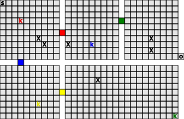

# Java Fuzz Testing

A Java fuzzing tool developed for SWEN438 at Victoria University of Wellington. The program explores a Chip's Challenge game to identify runtime errors, using breadth-first search (BFS) and Java bytecode instrumentation.

## How It Works

The fuzzer systematically explores the game map using BFS, recording movement paths and tracking visited locations to avoid unnecessary exploration. When a key is collected, the search restarts from that location, allowing previously inaccessible areas to be explored.

The search continues until all reachable areas have been explored, rather than stopping when the game is completed. This allows the program to identify multiple errors in a single run.

Java bytecode instrumentation (ASM) is used to retrieve the player's coordinates and collected keys at runtime. A Java agent instruments the game's `Chip` class, allowing the fuzzer to access this information without modifying the original game code.

## Results

The program records detected exceptions and their coordinates in `crashes.csv`. It also generates a visualisation of the game map in `game-image.svg`.



## Requirements

- Java 17
- Apache Maven
- Chip's Challenge 1.1.0 JAR in `lib/`

## Run

Build the project:

```bash
mvn clean package -DskipTests
```

Run with dynamic Java agent attachment (Windows):

```bash
java -Djdk.attach.allowAttachSelf=true -cp "target/classes;lib/*" MainApp
```

The agent can also be attached statically using Java's `-javaagent` option. For dynamic attachment, `MainApp` must attach the agent before accessing the instrumented game classes.

Run the tests:

```bash
mvn test
```